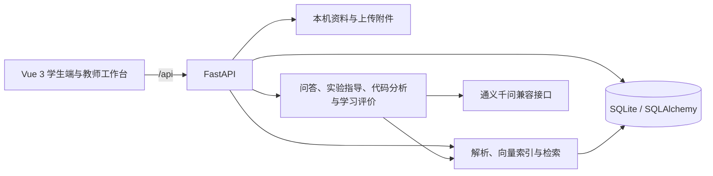

# 技术说明

## 系统结构

开发时 Vite 将 `/api` 代理至默认的 `127.0.0.1:8001`。FastAPI 在启动时创建数据表，并对现有表添加少量兼容字段；这不是完整的迁移框架，重要数据升级前应备份。

## 主要模块

| 路径 | 职责 |
| --- | --- |
| `backend/app/main.py` | HTTP 路由、文件权限、任务提交、教师复核与下载 |
| `backend/app/api/schemas.py` | Pydantic 请求结构与校验 |
| `backend/app/database/models.py` | 资料、对话、学生信息、作业提交、版本和复核事件等表 |
| `backend/app/database/session.py` | 数据库连接、建表和兼容字段迁移 |
| `backend/app/knowledge/` | PPT/Word/PDF 解析、向量索引、检索、任务与模板提取 |
| `backend/app/agents/` | 问题调度、模型调用、离线回复与学习回顾 |
| `frontend/src/App.vue` | 学生与教师界面、状态及请求流程 |
| `frontend/src/document-rendering.js` | 任务与资料正文渲染 |

## 资料与任务流

1. 导入脚本解析原始资料，建立可追溯的文件、页码或文字片段记录。本地向量模型用于语义检索。
2. 两份指定指导手册产生任务目录；任务要求可包含表格、代码和配图。报告模板通过资料名与模块映射，实际文件由下载接口提供。
3. 教师修改任务时写入 `assignment_versions`。目录读取时叠加最新版本；新提交保存任务版本号及当时要求和评分标准的快照。
4. 学生提交的文字、附件、AI 初评与教师复核分别保存。修订会创建新提交并通过 `revised_from_id` 关联原记录。
5. 教师复核写入当前状态和 `assignment_review_events` 历史。教师删除通过时间戳从界面隐藏记录，附件不立即物理删除。

## API 摘要

完整交互文档运行后查看 `/docs`。以下是主要入口：

| 方法与路径 | 用途 |
| --- | --- |
| `GET /api/status` | 模型、课程资料与索引状态 |
| `GET /api/assignments`、`GET /api/assignments/{id}` | 任务目录与完整要求 |
| `GET /api/assignments/{id}/report-template` | 下载当前任务报告模板 |
| `POST /api/assignments/{id}/grade` | 学生提交并生成 AI 初评 |
| `GET /api/assignments/{id}/submissions` | 当前学生的提交记录 |
| `PUT /api/assignments/{id}/submissions/{submission_id}` | 修订并创建新版本提交 |
| `GET /api/teacher/assignments`、`GET /api/teacher/assignments/{id}` | 教师任务、提交统计及任务版本 |
| `PUT /api/teacher/assignments/{id}` | 保存任务要求和评分标准的新版本 |
| `GET /api/teacher/submissions/{id}` | 教师查看单条提交、评分及复核历史 |
| `POST /api/teacher/submissions/{id}/review` | 保存复核状态、意见与最终分数 |
| `GET /api/teacher/submissions/{id}/download?group=all\|work\|report` | 打包下载全部、作品或报告 |
| `DELETE /api/teacher/submissions/{id}` | 教师从界面删除单条提交 |
| `GET /api/teacher/analytics` | 学情分析 |
| `POST /api/chat`、`POST /api/code/analyze`、`POST /api/learning/summary` | 问答、代码分析、学习回顾 |

教师接口使用请求头 `X-Teacher-Code`。学生记录通过浏览器保存的 `X-Student-Key` 关联。两者只满足本机演示需求，公开部署前应改为服务端身份认证与授权。

## 数据与限制

- `.env`、SQLite 数据库、索引、原始课程资料、模型缓存、上传图片与作业附件均在 `.gitignore` 中。
- 课程资料可能涉及版权，学生提交可能涉及个人信息；发布代码不等于授权发布这些数据。
- AI 评分依赖外部模型服务，结果并非确定性测试或现场验收。模型无法通过静态材料确认真实设备运行。
- 代码分析不执行学生代码。教师上传资料和学生附件应只在可信本机演示环境使用。
- 本地访问码、浏览器学生标识与 SQLite 适合演示；多用户生产部署需要正式认证、细粒度授权、数据库迁移、备份、监控和文件安全处理。
